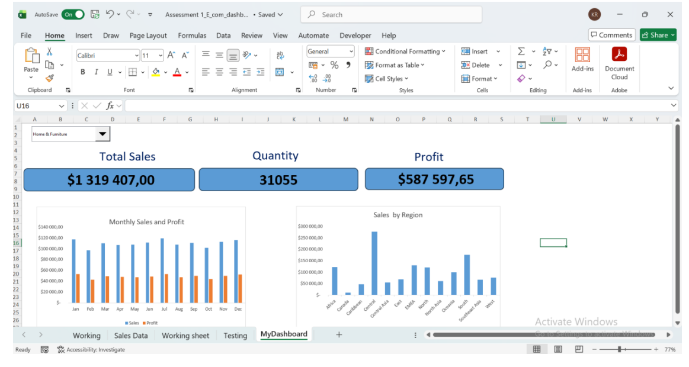

# E-Commerce Sales Dashboard

A dynamic Excel dashboard engineered to analyze multi-dimensional sales, quantity, and profit performance across product categories, monthly timelines, and geographical regions.

## 📸 Dashboard Preview

## 📁 Repository Contents
This directory contains the end-to-end deliverables for the project:
* **`ECommerce_Dashboard.xlsx`**: The dynamic, formula-driven Excel dashboard utilizing interactive form controls.
* **`ECommerce_Dashboard Brief.pdf`**: Project requirements, business questions, and scoping documentation.
* **`Dashboard_Development_Report.pdf`**: Full technical documentation detailing formula architecture, data modeling challenges, and analytical conclusions.
* **`ECommerce_Dashboard_Visuals .pdf`**: High-resolution static visuals and design exports of the dashboard.
* **`E_commerce_Dashboard.png`**: Preview image of the primary dashboard interface.

## 🎯 Business Objective
To provide sales leadership and category managers with an interactive decision-support tool capable of evaluating month-by-month and product-by-product performance trends, identifying profit drivers, and isolating regional sales variations.

## 🛠️ Technical Architecture & Tools
* **Dynamic Interactivity:** Form Controls (Combo Boxes) linked to dynamic cell translators to switch product categories and parameters in real time.
* **Data Modeling & Calculation:** Multi-argument `SUMIFS` modeling configured across dynamic criteria ranges to aggregate sales, quantity, and profit without absolute referencing bottlenecks.
* **Data Presentation:** Category-level trend charts, regional distribution breakdowns, and structured key metric summary tables.

## 💡 Key Highlights & Findings
* **Dynamic Category Filtering:** Users can isolate specific product categories to evaluate localized month-by-month trajectory shifts.
* **Multi-Dimensional Metrics:** Real-time calculation of revenue, unit volume, and net profit margins mapped across both time and geography.
* **Formula Optimization:** Replaced static pivot structures with fully dynamic criteria formulas linked directly to translation cells, preventing reference errors across manual category updates.

## 🚀 How to Use
1. Download [ECommerce_Dashboard.xlsx](ECommerce_Dashboard.xlsx).
2. Open the file in **Microsoft Excel** (Desktop version recommended for native Form Control support).
3. Use the embedded **Combo Box dropdowns** to toggle product categories and examine real-time metric updates across the tables and visuals.
