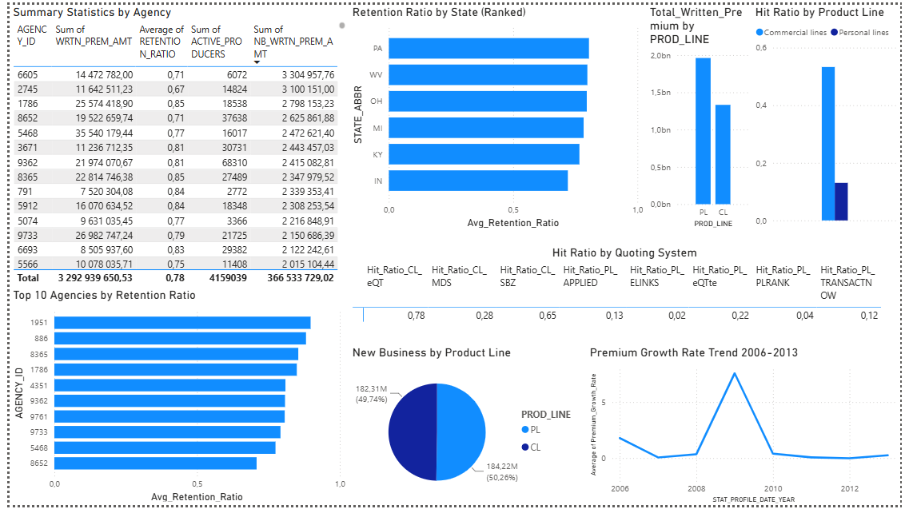

# Insurance Performance Analytics Dashboard

A Power BI business intelligence project focused on analysing insurance underwriting performance, premium production, quote-to-bind conversion, policy retention, and loss ratios across Commercial and Personal Lines.

The dashboard transforms insurance performance data into actionable insights, helping stakeholders evaluate portfolio performance, monitor distribution channels, and assess underwriting effectiveness.

---

## Project Overview

The **Insurance Performance Analytics Dashboard** provides a consolidated view of key insurance performance indicators through interactive Power BI visualisations and DAX-based calculations.

The project examines how effectively insurance quotations are converted into bound policies, how much written premium is generated, and how the insurance portfolio performs in terms of retention and loss ratios.

The analysis covers two primary business segments:

- **Commercial Lines (CL)**
- **Personal Lines (PL)**

It also evaluates the performance of different agency automation and quoting platforms to support distribution channel analysis and underwriting decision-making.

## Business Objectives

The primary objectives of this project are to:

- Monitor total written premium generated across insurance policies.
- Evaluate quote-to-bind conversion rates across Commercial and Personal Lines.
- Compare the performance of individual quoting and distribution platforms.
- Assess policy retention and identify indicators of renewal performance.
- Monitor loss ratios to evaluate underwriting risk and portfolio performance.
- Provide a consolidated view of insurance performance through an interactive dashboard.

## Key Performance Indicators (KPIs)

| KPI | Description |
|---|---|
| Total Written Premium | Total premium generated from bound insurance policies. |
| Commercial Lines Hit Ratio | Percentage of Commercial Lines quotations converted into bound policies. |
| Personal Lines Hit Ratio | Percentage of Personal Lines quotations converted into bound policies. |
| Platform Hit Ratio | Quote-to-bind conversion performance for individual distribution platforms. |
| Average Retention Ratio | Average policy retention rate, indicating policyholder continuity. |
| Average Loss Ratio | Average loss ratio, providing an indication of underwriting risk and claims performance. |

### Understanding the Hit Ratio

The hit ratio measures the effectiveness of converting insurance quotations into bound policies.

$$ \text{Hit Ratio} = \frac{\text{Bound Policies}}{\text{Quoted Policies}} \times 100 $$
A higher hit ratio generally indicates stronger quote conversion performance.

The dashboard evaluates conversion performance across the following platforms:

**Commercial Lines**
- eQT
- MDS
- SBZ

**Personal Lines**
- APPLIED
- ELINKS
- eQTte
- PLRANK
- TRANSACTNOW

## Analytical Approach

The project uses Power BI and DAX to calculate, aggregate, and evaluate insurance performance metrics.

### 1. Premium Analysis

Written premium is aggregated to evaluate premium production across the insurance portfolio.

The primary measure is:

```dax
Total_Written_Premium =
SUM(finalapi[WRTN_PREM_AMT])
```

### 2. Quote-to-Bind Conversion Analysis

DAX measures calculate the hit ratio for each distribution platform and insurance segment.

Commercial Lines:

```dax
Commercial lines =
DIVIDE(
    SUM(finalapi[CL_BOUND_CT_MDS]) +
    SUM(finalapi[CL_BOUND_CT_SBZ]) +
    SUM(finalapi[CL_BOUND_CT_eQT]),

    SUM(finalapi[CL_QUO_CT_MDS]) +
    SUM(finalapi[CL_QUO_CT_SBZ]) +
    SUM(finalapi[CL_QUO_CT_eQT]),

    0
)
```

Personal Lines:

```dax
Personal lines =
DIVIDE(
    SUM(finalapi[PL_BOUND_CT_ELINKS]) +
    SUM(finalapi[PL_BOUND_CT_PLRANK]) +
    SUM(finalapi[PL_BOUND_CT_eQTte]) +
    SUM(finalapi[PL_BOUND_CT_APPLIED]) +
    SUM(finalapi[PL_BOUND_CT_TRANSACTNOW]),

    SUM(finalapi[PL_QUO_CT_ELINKS]) +
    SUM(finalapi[PL_QUO_CT_PLRANK]) +
    SUM(finalapi[PL_QUO_CT_eQTte]) +
    SUM(finalapi[PL_QUO_CT_APPLIED]) +
    SUM(finalapi[PL_QUO_CT_TRANSACTNOW]),

    0
)
```

The `DIVIDE()` function provides a fallback value of zero when the denominator is zero, helping prevent division errors.

### 3. Loss Ratio Analysis

The average loss ratio is calculated while excluding blank values:

```dax
Avg_Loss_Ratio =
CALCULATE(
    AVERAGE(finalapi[LOSS_RATIO]),
    NOT(ISBLANK(finalapi[LOSS_RATIO]))
)
```

This measure supports the evaluation of claims performance relative to the underlying insurance portfolio.

### 4. Retention Analysis

The average retention ratio is calculated using:

```dax
Avg_Retention_Ratio =
AVERAGE(finalapi[RETENTION_RATIO])
```

This KPI provides an indication of policyholder retention and renewal performance.

## Technology Stack

| Technology | Purpose |
|---|---|
| Microsoft Power BI | Interactive dashboard development and data visualisation. |
| DAX | KPI calculations, aggregations, and business logic. |
| Data Modelling | Structuring insurance performance data for analysis. |
| PDF Reporting | Documentation and presentation of dashboard outputs. |
| Git & GitHub | Version control and project documentation. |

## Repository Structure

```text
Insurance_Performance_Analytics/
│
├── README.md
│
├── DAX_Measures.md.txt
│
├── Insurance_Performance_Analytics_Dashboard.pbix
│
├── Dashboard_visual.pdf
│
├── Insurance_Performance_Analytics_Report.pdf
│
├── Insurance_Performance_Analytics_Full_Report.pdf
│
├── Insurance_Performance_Analytics_Visuals.pdf
│
└── Insurance_Performance_Analytics_brief.pdf
```

## Dashboard & Project Deliverables

The repository includes the following deliverables:

| File | Description |
|---|---|
| `Insurance_Performance_Analytics_Dashboard.pbix` | Main interactive Power BI dashboard. |
| `DAX_Measures.md.txt` | Collection of DAX calculations used in the project. |
| `Dashboard_visual.pdf` | PDF representation of dashboard visuals. |
| `Insurance_Performance_Analytics_Report.pdf` | Supporting project report. |
| `Insurance_Performance_Analytics_Full_Report.pdf` | Full project report. |
| `Insurance_Performance_Analytics_Visuals.pdf` | Supporting dashboard visualisations. |
| `Insurance_Performance_Analytics_brief.pdf` | Project brief. |

## How to Access the Dashboard

1. Clone or download this repository.
2. Navigate to the `Insurance_Performance_Analytics` folder.
3. Open `Insurance_Performance_Analytics_Dashboard.pbix` using Microsoft Power BI Desktop.
4. Review the dashboard and interact with the available visualisations and filters.
5. Refer to `DAX_Measures.md.txt` for the underlying KPI calculations.

**Note:** The Power BI report uses the `finalapi` data model. If the report requests a data source or credentials, the relevant source connection may need to be configured before refreshing the data.

## Business Value

The project demonstrates how business intelligence can support insurance performance management by:

- Improving visibility into premium production and underwriting performance.
- Identifying distribution platforms with stronger quote conversion rates.
- Supporting comparisons between Commercial and Personal Lines.
- Monitoring portfolio retention and loss ratios.
- Providing a consistent, KPI-driven foundation for performance evaluation.

These insights can help insurance stakeholders identify performance gaps, investigate conversion opportunities, and make more informed underwriting and distribution decisions.

## Skills Demonstrated

- Business Intelligence and Data Analytics
- Microsoft Power BI
- DAX (Data Analysis Expressions)
- KPI Development and Performance Measurement
- Insurance and Underwriting Analytics
- Data Modelling
- Data Visualisation
- Business Performance Reporting

---

**Project:** Insurance Performance Analytics  
**Category:** Business Intelligence | Insurance Analytics  
**Primary Tool:** Microsoft Power BI  
**Repository:** [Data Science Playground](https://github.com/ElScara/data-science-playground)
